# PRAMAAN (प्रमाण)
### AI-Powered Real-Time Compliance & Attendance Monitoring for Skill Training Centres

[](https://www.sih.gov.in/)
[](https://fastapi.tiangolo.com)
[](https://react.dev)
[](https://www.typescriptlang.org)
[](backend/tests)
[](backend/tests)
[](LICENSE)

---

## 📌 Executive Summary

**PRAMAAN (प्रमाण)** is an edge-to-cloud compliance and attendance monitoring system designed for skill development centres under **MSDE (Ministry of Skill Development and Entrepreneurship)** schemes (e.g., PMKVY).

The system addresses critical challenges in remote vocational training: **fraudulent ghost batches**, **physical camera tampering / relocation**, and **attendance inflation**, while strictly upholding a **Privacy-First, Zero-Biometric, Ultra-Low Bandwidth** architecture.

```
+---------------------------------------------------------------------------------------------------+
|  PRIVACY FIRST: Zero Facial Recognition  •  Zero Video Transmitted  •  ~500 Bytes/Min Telemetry  |
+---------------------------------------------------------------------------------------------------+
```

---

## 🏛️ Core Pillars & Key Innovations

```mermaid
flowchart TD
    subgraph Edge ["1. Edge Processing (Laptop / Edge Box)"]
        Cam["Live Camera / Webcam (DirectShow 640x480)"] -->|Raw Frames| YOLO["Ultralytics YOLOv8n (CPU Inference)"]
        YOLO -->|Frame Bounding Boxes| Discard["Immediate Raw Frame Discard\n(Zero Video Stored/Sent)"]
        YOLO --> Agg["1-Minute Rolling Aggregator\n(min, median, P90, max, feed health)"]
        Agg --> Crypto["Ed25519 Digital Signer\n& SHA-256 Hash Chaining"]
        KeyFile[".webcam_state/device_key.json"] -->|Private Key| Crypto
    end

    Crypto -->|HTTPS POST ~486 B/min| Ingest["/v1/ingest/observations"]

    subgraph Backend ["2. Core Backend Platform (FastAPI & DB)"]
        Ingest --> IngestSvc["Ingestion Service"]
        IngestSvc --> AuthCheck["Ed25519 Signature, Sequence,\nClock Skew & Hash Chain Verify"]
        AuthCheck --> Dedupe["Deduplication Cache"]
        AuthCheck --> ReconEngine["Attendance Reconciliation Engine\n(P90 Occupancy vs Claimed)"]
        
        subgraph IntegrityModules ["Tamper & Fraud Detection Engines"]
            CamInt["Server-Side Camera Integrity\n(pHash, ORB+RANSAC, SSIM, HSV)"]
            GhostEngine["Multi-Day Ghost Batch Engine\n(M-of-N, L-Consecutive, CUSUM)"]
            AuditTrail["Append-Only Audit Log\n(SHA-256 Chained History)"]
        end
        
        ReconEngine --> Flags["Compliance Flags & Cases"]
        CamInt -->|On Swap / Drift| Untrusted["Tag UNTRUSTED\n(Non-Punitive Telemetry)"]
        EventBus["In-Process EventBus"] --> WS["WebSocket / SSE Stream"]
    end

    subgraph Frontend ["3. Administrative Dashboard (React 19 SPA)"]
        WS --> QueryCache["TanStack React Query"]
        QueryCache --> UI["National Overview • Centres Map • Camera Integrity\nGhost Batch Grid • Audit Log • Flags & Case Workflow"]
    end
```



### 1. 🛡️ Privacy-by-Design & Zero-Biometrics
- **No Face Detection / No Biometrics**: Operates exclusively with generic `person` class bounding boxes via YOLOv8n.
- **Immediate Frame Discard**: Raw video frames are analyzed locally in memory and destroyed immediately. No video footage is ever stored on edge disk or streamed over the internet.
- **Redaction Masks**: Server-side baseline comparisons exclude masked personal polygon regions (blurred faces and bodies).

### 2. ⚡ Ultra-Low Bandwidth Telemetry
- Transmits **~486 bytes per minute per camera** (~29.1 KB/hour) in serialized RFC 8785 canonical JSON.
- Requires less than **0.008 KB/s** bandwidth, allowing seamless operation over 2G/3G rural cellular connections.

### 3. 🔐 Cryptographic Authenticity & Tamper Evidence
- **Ed25519 Asymmetric Signatures**: Every observation packet is cryptographically signed by the enrolled edge hardware.
- **Continuous SHA-256 Hash Chain**: Observations form an unbroken sequence chain (`prev_hash` $\to$ `record_hash`). Any dropped or fabricated packets immediately trigger a `CHAIN_BREAK` integrity alert.
- **Clock-Skew & Replay Protection**: Enforces $\pm 300\text{s}$ timestamp tolerance and 24-hour hash deduplication.

### 4. 🎯 Intelligent Reconciliation & Non-Punitive Safeguards
- Evaluates attendance ratios using statistical occupancy ($O_{\text{hat}}$ P90) against claimed attendance.
- Automatically assigns compliance tiers:
  - 🟢 **GREEN** ($\ge 0.85$): Normal compliance
  - 🟡 **AMBER** ($0.55 - 0.85$): Minor variance / monitoring
  - 🔴 **RED** ($< 0.55$): Significant discrepancy / flag created
  - ⚪ **NO_DATA / UNTRUSTED**: If a camera feed fails or camera tampering is detected, telemetry is tagged `UNTRUSTED` and explicitly **exempted from student attendance penalties**.

### 5. 👁️ Server-Side Camera Swap & Relocation Detection
- Detects physical camera movement, swapping, or replacement using a 4-layer computer vision pipeline:
  - **Perceptual Hash (pHash)**: Broad structural shift detection
  - **ORB Feature Matching with RANSAC**: Homography and geometric alignment
  - **Masked Structural Similarity (SSIM)**: Luminance and contrast comparison
  - **HSV Color Histograms**: Environmental lighting and color distribution
- Governed by a **K-of-M temporal state machine** (`STABLE` $\to$ `DRIFT_SUSPECTED` $\to$ `SWAP_CONFIRMED`).

### 6. 📅 Multi-Day Ghost Batch Detection
- Tracks systemic attendance fraud across multi-day rolling calendar windows in Indian Standard Time (IST).
- Employs **M-of-N shortfall**, **L-consecutive absence**, and **CUSUM trend analysis** before opening formal compliance cases.

### 7. 📜 Tamper-Evident Immutable Audit Log
- All administrative actions (case resolutions, threshold adjustments, re-evaluations) are committed to an append-only audit repository protected by an unbroken SHA-256 hash chain.

---

## 📊 Measured Performance Benchmarks

All metrics measured directly on local development hardware (AMD64 16 vCPUs, 16 GB RAM, Windows 11):

| Metric | Measured Result | Measurement Details |
|---|---|---|
| **YOLOv8n CPU Inference** | **35 – 55 ms / frame** (18–25 FPS) | Measured during live webcam capture |
| **Observation Payload Size** | **486 bytes** | Serialized canonical JSON per minute |
| **Edge Bandwidth Consumption** | **0.008 KB/s** (~29.1 KB/hr) | Zero video transmission |
| **Keyframe Comparison Latency (p50)** | **29.03 ms** | OpenCV pHash + ORB + SSIM benchmark |
| **Keyframe Comparison Latency (p95)** | **40.89 ms** | 50 iterations at 480x360 px |
| **Ghost Batch Engine Throughput** | **2,825.4 batches / sec** | 1,000 14-day evaluation windows |
| **Backend Test Suite (Pytest)** | **207 Passed in 14.5s** | 71% statement coverage |
| **Frontend Production Build** | **1.62 seconds** | Vite 8 + TypeScript compilation |

---

## 🛠️ Technology Stack

| Layer | Technologies |
|---|---|
| **Edge Device & CV** | Python 3.11+, Ultralytics YOLOv8n, OpenCV (DirectShow), NumPy, PyNaCl (Ed25519) |
| **Backend API** | FastAPI 0.115, Uvicorn, Starlette, Pydantic v2, Python-Jose (JWT), SlowAPI |
| **Database & ORM** | SQLAlchemy 2.0 (Async), Alembic, SQLite (dev) / PostgreSQL & TimescaleDB (prod) |
| **Vision Analytics** | scikit-image (SSIM), imagehash (pHash), OpenCV Feature2D (ORB+RANSAC) |
| **Task Queue / Cache** | Redis 5.3, ARQ (with automatic inline synchronous fallback for dev) |
| **Frontend Dashboard** | React 19, Vite 8, TypeScript 5.8, Tailwind CSS, TanStack React Query, Lucide Icons, Recharts, Leaflet |
| **Testing & Quality** | Pytest, Hypothesis (Property Testing), Pytest-Cov, Oxlint, Ruff, Mypy |

---

## 📂 Project Structure

```text
├── backend/
│   ├── app/
│   │   ├── adapters/          # CSV & REST adapters for attendance/timetables
│   │   ├── api/v1/            # 50 REST & WebSocket endpoints (Centres, Cases, Ghost, Ingest, etc.)
│   │   ├── core/              # Security policies, RBAC, JWT, Ed25519 key logic
│   │   ├── db/                # SQLAlchemy async models (28 tables), repositories, seed data
│   │   ├── domain/            # Pure business logic (Reconciliation, Camera Integrity, Ghost Batches)
│   │   │   └── vision/        # Multi-metric scene comparison (pHash, ORB, SSIM, HSV)
│   │   ├── events/            # In-process asynchronous EventBus
│   │   ├── jobs/              # Background workers and reconciliation tasks
│   │   └── services/          # Orchestration layer (Ingestion, Evidence, Camera, Ghost)
│   ├── docs/                  # Architecture, Data Contract, Security & Privacy specs
│   ├── scripts/               # Webcam edge agent, demo setup & smoke test scripts
│   └── tests/                 # 207 unit, scenario, property & integration tests
│
├── frontend/
│   ├── src/
│   │   ├── api/               # Typed API client modules for all 12 backend domains
│   │   ├── components/        # Layout, charts, visual comparison sliders, gauges
│   │   ├── hooks/             # Custom React Query hooks with live WebSocket cache invalidation
│   │   ├── pages/             # 10 comprehensive dashboard views
│   │   └── types.ts           # Unified TypeScript domain schemas
│   └── package.json
│
├── docs/                      # Project Fact Sheet & Verification Reports
└── scripts/                   # Local verification and reconciliation runners
```

---

## 🚀 Quickstart Guide

### Prerequisites
- **Python 3.11+** installed
- **Node.js 18+** and **npm** installed
- Integrated or USB Webcam (for live edge demonstration)

---

### 1. Backend Setup & Run

```powershell
# Navigate to backend directory
cd backend

# Create and activate virtual environment
python -m venv .venv
.venv\Scripts\activate

# Install dependencies
pip install -r requirements.txt # or pip install -e .

# Initialize development database & mock keys
python scripts/setup_local_webcam_demo.py

# Start the FastAPI server (Port 8000)
python -m uvicorn app.main:create_app --factory --host 127.0.0.1 --port 8000
```
Backend will be live at `http://127.0.0.1:8000` (`GET /v1/healthz`).

---

### 2. Run Automated Verification Suite (207 Tests)

```powershell
# Run the complete test suite
python -m pytest --tb=short

# Run the 10-stage end-to-end automated smoke test
python backend/scripts/smoke_test_e2e.py
```

---

### 3. Launch Live Webcam Edge Agent

In a separate terminal (with the backend running):

```powershell
# Run edge ingestion using live webcam
python backend/scripts/webcam_edge_agent.py --interval-seconds 10
```
The edge agent opens your local webcam, detects occupants in real time, computes min/median/P90/max, cryptographically signs the payload, and uploads it to the backend.

---

### 4. Frontend Setup & Run

In another terminal:

```powershell
# Navigate to frontend directory
cd frontend

# Install dependencies
npm install

# Start Vite development server (Port 5173)
npm run dev
```
Open **`http://localhost:5173`** in your browser to view the administrative dashboard.

---

## 🖥️ Dashboard Features

| View | Capabilities |
|---|---|
| **National Overview** | High-level compliance KPIs, active sessions count, national risk distribution, recent compliance flag feed. |
| **Centres Map & Directory** | Interactive map (Leaflet) of skill centres, state-level filters, risk tier badges, and drilldown inspection. |
| **Centre Detail Drilldown** | Live session attendance charts, registered cameras, enrolled edge hardware, and historical risk trends. |
| **Camera Integrity Studio** | Visual comparison slider (`CompareSlider`) comparing baseline reference images against current camera view, swap alerts, and challenge prompts. |
| **Ghost Batches Explorer** | Multi-day IST attendance calendar grid showing historical shortfall patterns, CUSUM analytics, and non-punitive exemption states. |
| **Flags & Cases Workflow** | Complete investigation lifecycle: inspector evidence review, TC response submission, and official case resolution. |
| **Edge Hardware Console** | Real-time device telemetry status, last heartbeat timestamps, hash-chain heights, and manual provisioning controls. |
| **Tamper-Evident Audit Log** | Chronological record of all administrative actions with real-time SHA-256 hash verification indicators. |
| **Thresholds & Settings** | Dynamic parameter tuning ($T_{\text{green}}$, $T_{\text{amber}}$, feed health minimums, repeat thresholds) with role-based restriction. |
| **Accuracy & Limits Disclosure** | Transparent documentation of optical boundaries, detection uncertainties, and non-punitive governance safeguards. |

---

## 📡 API Overview (50 Endpoints)

| Domain | Key Endpoints | Description |
|---|---|---|
| **Ingestion** | `POST /v1/ingest/observations` | Ingests signed minute-level telemetry from edge devices. |
| **Devices** | `POST /v1/device/enroll`, `POST /v1/device/heartbeat`, `GET /v1/devices` | Device registration, public key storage, and health tracking. |
| **Centres & Sessions** | `GET /v1/centres`, `GET /v1/sessions/{id}`, `GET /v1/centres/{id}/risk` | Centre metadata, class schedules, and calculated risk scores. |
| **Camera Integrity** | `GET /v1/cameras`, `POST /v1/cameras/{id}/challenge`, `POST /v1/cameras/{id}/rebaseline` | Camera metadata, reference keyframes, and swap verification. |
| **Ghost Batches** | `GET /v1/ghost-assessments`, `POST /v1/ghost/re-evaluate/{batch_id}` | Multi-day batch assessments and escalation state machines. |
| **Flags & Cases** | `GET /v1/flags`, `POST /v1/flags/{id}/resolve`, `POST /v1/cases/{id}/respond` | Compliance anomaly management and TC dispute responses. |
| **Evidence Storage** | `POST /v1/evidence/presign`, `GET /v1/evidence/{id}/view` | S3-compatible presigned upload and view URLs (300s expiry). |
| **Audit Log** | `GET /v1/audit-log` | Tamper-evident, hash-chained administrative action history. |
| **Realtime Events** | `WS /v1/events/ws`, `GET /v1/events/stream` (SSE) | Real-time WebSocket and Server-Sent Events push stream. |
| **Health** | `GET /v1/healthz`, `GET /v1/readyz` | Liveness and readiness probes. |

---

## 🔒 Security & Privacy Commitments

1. **Zero Personally Identifiable Information (PII)**: No face encodings, names, or biometric identifiers are collected or stored.
2. **Cryptographic Accountability**: Every observation is signed by hardware-held private keys and validated against the enrolled public key.
3. **Transparent Non-Punitive Rules**: System outages, network drops, or camera swaps never trigger automatic student penalties; instead, telemetry is tagged `UNTRUSTED` or `NO_DATA`.
4. **Scanned Audit Trail**: Modifications to compliance thresholds or case statuses are cryptographically chained to prevent historical alteration.

---

## 👥 Contributors & Acknowledgements

Developed for the **Smart India Hackathon (SIH 2024)** under Problem Statement **PS 26245**: *AI-Based Real-Time Monitoring of Training Centres for Attendance and Infrastructure Compliance (MSDE)*.

---

## 📄 License

This project is licensed under the MIT License — see the [LICENSE](LICENSE) file for details.
