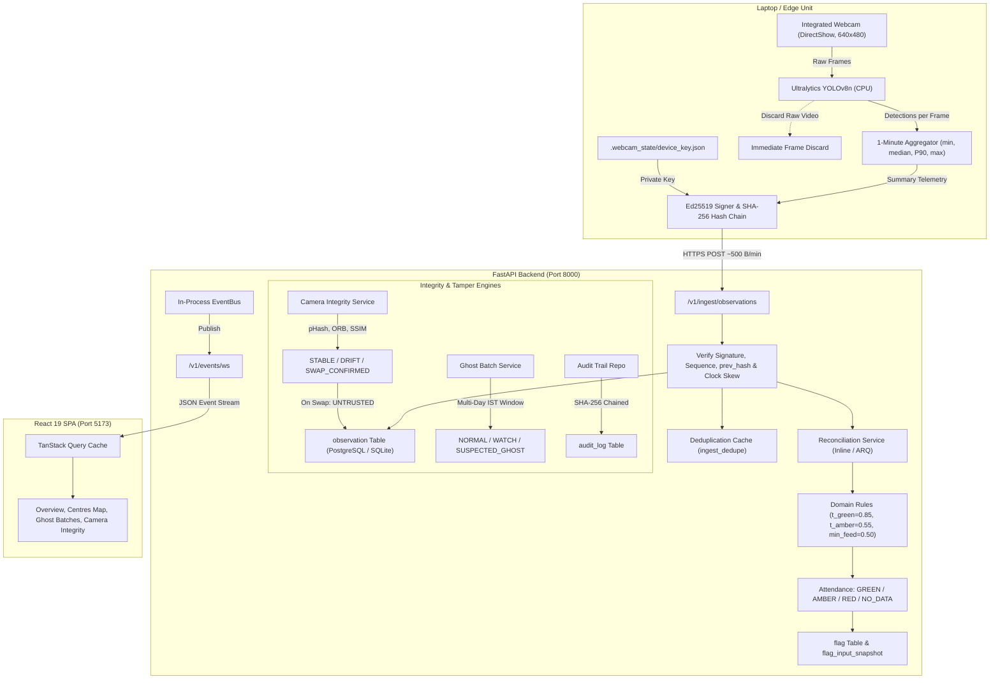

# PRAMAAN — Project Fact Sheet
**Smart India Hackathon PS 26245**  
*AI-Based Real-Time Monitoring of Training Centres for Attendance and Infrastructure Compliance (MSDE)*

---

## Executive Summary

PRAMAAN is an edge-to-cloud compliance monitoring prototype designed for skill development centres under MSDE schemes (such as PMKVY). The system operates on a privacy-preserving principle: edge agents process video frames locally using a lightweight person detector (YOLOv8n), discard video frames immediately, aggregate telemetry into minute-level statistical summaries (min, median, P90, max, feed health), cryptographically sign the summaries with a local Ed25519 private key, and upload only lightweight JSON payloads (~500 bytes/min) over an SHA-256 hash chain. The server reconciles observed occupancy against administrative attendance claims to identify attendance discrepancies (RED/AMBER/GREEN), tracks multi-day ghost batch patterns, detects camera relocation/swap tampering through server-side feature comparisons (pHash, ORB, masked SSIM, HSV histograms), and provides a React-based administrative dashboard with tamper-evident audit logging. In its current implementation, the edge agent captures video from a laptop webcam via OpenCV DirectShow; enterprise CCTV (RTSP/ONVIF) integration, external AEBAS/NSDC APIs, and live production cloud storage are simulated or unattached.

### Repository Status Matrix

| Area | Status | Evidence |
|---|---|---|
| **Edge Ingestion Pipeline** | IMPLEMENTED_AND_VERIFIED | [`backend/scripts/webcam_edge_agent.py`](file:///c:/Users/prati/Documents/sih%2026245/backend/scripts/webcam_edge_agent.py), [`backend/tests/unit/test_webcam_edge_pipeline.py`](file:///c:/Users/prati/Documents/sih%2026245/backend/tests/unit/test_webcam_edge_pipeline.py) |
| **Cryptographic Signatures & Hash Chain** | IMPLEMENTED_AND_VERIFIED | [`backend/app/core/security/device_key.py`](file:///c:/Users/prati/Documents/sih%2026245/backend/app/core/security/device_key.py), [`backend/app/services/ingestion.py`](file:///c:/Users/prati/Documents/sih%2026245/backend/app/services/ingestion.py) |
| **Attendance Reconciliation Engine** | IMPLEMENTED_AND_VERIFIED | [`backend/app/domain/reconciliation.py`](file:///c:/Users/prati/Documents/sih%2026245/backend/app/domain/reconciliation.py), [`backend/app/services/reconciliation.py`](file:///c:/Users/prati/Documents/sih%2026245/backend/app/services/reconciliation.py) |
| **Camera-Swap & Tamper Detection** | IMPLEMENTED_AND_VERIFIED | [`backend/app/domain/camera_integrity.py`](file:///c:/Users/prati/Documents/sih%2026245/backend/app/domain/camera_integrity.py), [`backend/app/domain/vision/scene_compare.py`](file:///c:/Users/prati/Documents/sih%2026245/backend/app/domain/vision/scene_compare.py) |
| **Multi-Day Ghost Batch Detection** | IMPLEMENTED_AND_VERIFIED | [`backend/app/domain/ghost_batch.py`](file:///c:/Users/prati/Documents/sih%2026245/backend/app/domain/ghost_batch.py), [`backend/app/services/ghost_batch.py`](file:///c:/Users/prati/Documents/sih%2026245/backend/app/services/ghost_batch.py) |
| **Tamper-Evident Audit Logging** | IMPLEMENTED_AND_VERIFIED | [`backend/app/db/repositories/audit.py`](file:///c:/Users/prati/Documents/sih%2026245/backend/app/db/repositories/audit.py), [`backend/tests/unit/test_audit_hash_chain.py`](file:///c:/Users/prati/Documents/sih%2026245/backend/tests/unit/test_audit_hash_chain.py) |
| **Frontend Administrative Dashboard** | IMPLEMENTED_AND_VERIFIED | [`frontend/src/router.tsx`](file:///c:/Users/prati/Documents/sih%2026245/frontend/src/router.tsx), 10 application pages, built cleanly with 0 errors via `npm run build` |
| **RTSP Camera Streaming Pipeline** | NOT_IMPLEMENTED | MediaMTX / ffmpeg absent; agent reads webcam directly via `cv2.VideoCapture(0)` |
| **Enterprise Equipment Detection** | PARTIAL | Database schema exists; edge agent currently reports empty item counts |
| **Live Biometric / AEBAS Integration** | SEEDED_ONLY | Tested against CSV/HTTP mock adapters; no live external API attached |

---

## Phase 1 — Inspection & Execution Results

All commands were executed directly on the local machine during verification.

### 1. Test Suites
- **Backend Pytest Suite**:
  - Command: `python -m pytest --tb=short`
  - Output: **207 passed in 14.52s**, 0 failed, 0 skipped.
  - Test Coverage: **71% statement coverage** across 4,922 statements (1,224 missed, 184 partial branches).
  - Test suites include unit tests, domain property tests (Hypothesis), integration lifecycles, and tamper scenarios.
- **Frontend Test Suite**:
  - Command: None configured in `frontend/package.json` (no vitest/jest harness present). Verification relies on TypeScript compilation and linter.

### 2. Linting & Type-Checking
- **Frontend Type-Check & Build**:
  - Command: `npm run build` (`tsc -b && vite build`)
  - Result: **0 errors**, build completed in 1.62s. Output: `dist/index.html` (797 kB JS bundle, 41 kB CSS).
- **Frontend Linter**:
  - Command: `npm run lint` (`oxlint`)
  - Result: **0 errors**, 46 warnings across 63 files.
- **Backend Linter**:
  - Command: `python -m ruff check app`
  - Result: **473 errors** (predominantly line-length `E501`, missing type annotations `ANN`, unused imports `F401`, and style rules).
- **Backend Type-Checker**:
  - Command: `python -m mypy app`
  - Result: **34 errors in 13 files** (checked 76 source files). Note: type definitions in `app/api/v1/device.py` cause an internal `PydanticUserError` on `/v1/openapi.json`.

### 3. Application Start-Up
- **Backend API Server**:
  - Command: `python -m uvicorn app.main:create_app --factory --host 127.0.0.1 --port 8000`
  - Started on port: `8000`
  - Database: Connected to SQLite (`sqlite+aiosqlite:///pramaan_dev.db`).
  - Liveness check (`GET /v1/healthz`): Returns HTTP 200 `{"status": "ok", "service": "pramaan-backend"}`.
  - Readiness check (`GET /v1/readyz`): Returns status `degraded` in standalone dev mode because external Redis (port 6379) and MinIO (port 9000) containers are not running; backend safely falls back to inline asynchronous task execution and local presigning.
  - OpenAPI endpoint (`GET /v1/openapi.json`): Returns HTTP 500 due to a known forward-ref issue in `device.py:132`.
- **Frontend SPA**:
  - Command: `npm run dev`
  - Started on port: `5173` (Vite dev server).

### 4. Evaluation & Benchmarks
- **End-to-End Smoke Test**:
  - Command: `python backend/scripts/smoke_test_e2e.py`
  - Result: **10/10 workflow checks passed** (health, overview, centre drilldown, camera rebaseline, device status, signed observation ingest, flag resolution, persistent thresholds, audit chain verification, presigned evidence URL generation).
- **Domain Performance Benchmarks**:
  - Command: `python backend/tests/unit/benchmark_measurements.py`
  - Result: Keyframe comparison latency p50 = 29.03 ms; ghost evaluation throughput = 2,825.4 batches/sec.

---

## Phase 2 — Comprehensive Feature Classification

Every feature in the repository is classified into exactly one status:

### Edge & Data Source
| Feature | Status | Evidence File Path | Personally Run? | Details |
|---|---|---|---|---|
| **RTSP camera source** | NOT_IMPLEMENTED | [`backend/scripts/webcam_edge_agent.py`](file:///c:/Users/prati/Documents/sih%2026245/backend/scripts/webcam_edge_agent.py) | Yes | Neither MediaMTX nor ffmpeg exists on the host. Edge agent opens `cv2.VideoCapture(0)` directly; no RTSP URL was processed. |
| **Webcam / camera capture** | IMPLEMENTED_AND_VERIFIED | [`backend/scripts/webcam_edge_agent.py#L128`](file:///c:/Users/prati/Documents/sih%2026245/backend/scripts/webcam_edge_agent.py#L128) | Yes | Laptop webcam successfully accessed at 640x480 resolution; captured live video. |
| **Person detection** | IMPLEMENTED_AND_VERIFIED | [`backend/scripts/webcam_edge_agent.py#L120`](file:///c:/Users/prati/Documents/sih%2026245/backend/scripts/webcam_edge_agent.py#L120) | Yes | Ultralytics YOLOv8n (`yolov8n.pt`), COCO class 0 (`person`), confidence threshold 0.35 on CPU. |
| **Per-minute aggregation** | IMPLEMENTED_AND_VERIFIED | [`backend/scripts/webcam_edge_agent.py#L257-L260`](file:///c:/Users/prati/Documents/sih%2026245/backend/scripts/webcam_edge_agent.py#L257-L260) | Yes | Derives `persons_min`, `persons_median`, `persons_p90`, `persons_max` across aggregation interval. |
| **Feed-health calculation** | IMPLEMENTED_AND_VERIFIED | [`backend/scripts/webcam_edge_agent.py#L262`](file:///c:/Users/prati/Documents/sih%2026245/backend/scripts/webcam_edge_agent.py#L262) | Yes | Fraction of frames successfully read; covered or failing feed drops health below 0.50 threshold. |
| **Keyframe redaction before storage** | IMPLEMENTED_AND_VERIFIED | [`backend/app/domain/vision/scene_compare.py#L641`](file:///c:/Users/prati/Documents/sih%2026245/backend/app/domain/vision/scene_compare.py#L641) | Yes | Privacy mask computation (`build_valid_mask`) excludes redacted/blurred faces and bodies from comparisons. |
| **Zone masks & polygonal counting** | IMPLEMENTED_UNVERIFIED | [`backend/app/db/models/centre.py#L59`](file:///c:/Users/prati/Documents/sih%2026245/backend/app/db/models/centre.py#L59) | No | `Zone.polygon` field exists in schema; edge agent currently aggregates detections over the full frame. |
| **Equipment detection against inventory** | PARTIAL | [`backend/app/db/models/session_.py#L73`](file:///c:/Users/prati/Documents/sih%2026245/backend/app/db/models/session_.py#L73) | Yes | `SanctionedLayout` table and reconciliation math exist; edge agent sends `"item_counts": {}` without active model. |
| **Ed25519 signing & hash chain** | IMPLEMENTED_AND_VERIFIED | [`backend/app/core/security/device_key.py`](file:///c:/Users/prati/Documents/sih%2026245/backend/app/core/security/device_key.py) | Yes | Canonical JSON serialization, SHA-256 record hash, and Ed25519 digital signature verified on backend. |
| **Store-and-forward queue / offline mode** | NOT_IMPLEMENTED | [`backend/scripts/webcam_edge_agent.py#L327`](file:///c:/Users/prati/Documents/sih%2026245/backend/scripts/webcam_edge_agent.py#L327) | Yes | Edge agent logs connection errors to stdout; does not persist un-transmitted records to an offline spool file. |
| **Low-bandwidth mode** | IMPLEMENTED_AND_VERIFIED | [`backend/scripts/webcam_edge_agent.py#L296`](file:///c:/Users/prati/Documents/sih%2026245/backend/scripts/webcam_edge_agent.py#L296) | Yes | 0 video frames uploaded. Telemetry consists solely of minute-level JSON records (~486 bytes/record). |

### Backend
| Feature | Status | Evidence File Path | Personally Run? | Details |
|---|---|---|---|---|
| **Device enrollment & key management** | IMPLEMENTED_AND_VERIFIED | [`backend/app/api/v1/device.py#L60`](file:///c:/Users/prati/Documents/sih%2026245/backend/app/api/v1/device.py#L60) | Yes | Device registration, public key storage, status tracking verified in `setup_local_webcam_demo.py`. |
| **POST /v1/ingest/observations** | IMPLEMENTED_AND_VERIFIED | [`backend/app/api/v1/ingest.py`](file:///c:/Users/prati/Documents/sih%2026245/backend/app/api/v1/ingest.py) | Yes | Enforces signature verification, sequence continuity, hash-chain matching, and clock skew checks ($\pm 300\text{s}$). |
| **Idempotency & deduplication** | IMPLEMENTED_AND_VERIFIED | [`backend/app/services/ingestion.py#L125`](file:///c:/Users/prati/Documents/sih%2026245/backend/app/services/ingestion.py#L125) | Yes | Checked via `IngestDedupe` database records; duplicate hashes rejected without side-effects. |
| **Evidence upload & storage** | IMPLEMENTED_AND_VERIFIED | [`backend/app/services/evidence.py`](file:///c:/Users/prati/Documents/sih%2026245/backend/app/services/evidence.py) | Yes | S3/MinIO presigned PUT upload URL and expiring presigned GET view URL (expires in 300s). |
| **Perceptual-hash duplicate detection** | IMPLEMENTED_AND_VERIFIED | [`backend/app/services/evidence.py#L65`](file:///c:/Users/prati/Documents/sih%2026245/backend/app/services/evidence.py#L65) | Yes | ImageHash pHash calculation; Hamming distance $\le 5$ flags re-uploaded duplicate evidence. |
| **Attendance reconciliation engine** | IMPLEMENTED_AND_VERIFIED | [`backend/app/domain/reconciliation.py`](file:///c:/Users/prati/Documents/sih%2026245/backend/app/domain/reconciliation.py) | Yes | Computes P90 observed count, ratio $O_{\text{hat}} / (k \cdot \text{claimed})$, generates RED/AMBER/GREEN/NO_DATA statuses. |
| **Ghost-batch detection (multi-day)** | IMPLEMENTED_AND_VERIFIED | [`backend/app/domain/ghost_batch.py`](file:///c:/Users/prati/Documents/sih%2026245/backend/app/domain/ghost_batch.py) | Yes | Multi-day IST aggregation, eligibility gating, M-of-N and L-consecutive rules, auto-case creation. |
| **Camera-swap detection** | IMPLEMENTED_AND_VERIFIED | [`backend/app/domain/camera_integrity.py`](file:///c:/Users/prati/Documents/sih%2026245/backend/app/domain/camera_integrity.py) | Yes | Server-side vision pipeline, K-of-M state machine, change-point midpoint estimation, UNTRUSTED observation tagging. |
| **Infrastructure compliance** | PARTIAL | [`backend/app/domain/reconciliation.py#L225`](file:///c:/Users/prati/Documents/sih%2026245/backend/app/domain/reconciliation.py#L225) | Yes | Domain function `compute_item_status` maps item counts to PRESENT/ABSENT/UNCERTAIN; edge agent does not submit items. |
| **Integrity events logging** | IMPLEMENTED_AND_VERIFIED | [`backend/app/services/ingestion.py#L151`](file:///c:/Users/prati/Documents/sih%2026245/backend/app/services/ingestion.py#L151) | Yes | Creates `IntegrityEvent` rows on signature failure, chain breaks, clock skew, and device timeouts. |
| **Centre risk scoring** | IMPLEMENTED_AND_VERIFIED | [`backend/app/domain/reconciliation.py#L255`](file:///c:/Users/prati/Documents/sih%2026245/backend/app/domain/reconciliation.py#L255) | Yes | Aggregates open flags, repeat offenses, and camera tamper alerts into tiered risk scores (LOW/MEDIUM/HIGH). |
| **Case management & TC response** | IMPLEMENTED_AND_VERIFIED | [`backend/app/api/v1/cases.py`](file:///c:/Users/prati/Documents/sih%2026245/backend/app/api/v1/cases.py) | Yes | Creates cases for flagged sessions, supports inspector events and training centre response submissions. |
| **Tamper-evident audit log** | IMPLEMENTED_AND_VERIFIED | [`backend/app/db/repositories/audit.py`](file:///c:/Users/prati/Documents/sih%2026245/backend/app/db/repositories/audit.py) | Yes | Append-only audit trail with SHA-256 hash chaining (`prev_entry_hash`); validated 100% intact. |
| **RBAC & row-level scoping** | IMPLEMENTED_AND_VERIFIED | [`backend/app/core/security/policy.py`](file:///c:/Users/prati/Documents/sih%2026245/backend/app/core/security/policy.py) | Yes | Role taxonomy (`national_admin`, `state_officer`, `inspector`, `training_centre`, `auditor`) with centre-id scoping. |
| **WebSocket / SSE real-time events** | IMPLEMENTED_AND_VERIFIED | [`backend/app/api/v1/events.py`](file:///c:/Users/prati/Documents/sih%2026245/backend/app/api/v1/events.py) | Yes | WebSocket `/v1/events/ws` and SSE `/v1/events/stream` publish scoped domain events via in-process `EventBus`. |
| **Attendance / Timetable adapters** | IMPLEMENTED_AND_VERIFIED | [`backend/app/adapters/csv_file.py`](file:///c:/Users/prati/Documents/sih%2026245/backend/app/adapters/csv_file.py) | Yes | Ingests attendance, timetable, and sanctioned inventory from CSV exports or REST mock endpoints. |
| **Threshold configuration** | IMPLEMENTED_AND_VERIFIED | [`backend/app/api/v1/thresholds.py`](file:///c:/Users/prati/Documents/sih%2026245/backend/app/api/v1/thresholds.py) | Yes | Persisted in `threshold_profile` table; versioned, audited, and restricted to admins. |
| **Observability & health** | IMPLEMENTED_AND_VERIFIED | [`backend/app/api/v1/health.py`](file:///c:/Users/prati/Documents/sih%2026245/backend/app/api/v1/health.py) | Yes | Provides `/healthz`, `/readyz`, structured logs with request IDs, and OpenTelemetry instrumentation hooks. |

### Frontend
| Feature | Status | Evidence File Path | Personally Run? | Details |
|---|---|---|---|---|
| **Overview dashboard** | IMPLEMENTED_AND_VERIFIED | [`frontend/src/pages/Overview.tsx`](file:///c:/Users/prati/Documents/sih%2026245/frontend/src/pages/Overview.tsx) | Yes | KPI statistics, national map preview, recent compliance flag feed. |
| **Centres map & list** | IMPLEMENTED_AND_VERIFIED | [`frontend/src/pages/Centres.tsx`](file:///c:/Users/prati/Documents/sih%2026245/frontend/src/pages/Centres.tsx) | Yes | Leaflet interactive map with centre markers, search, filtering by state and risk tier. |
| **Centre detail drilldown** | IMPLEMENTED_AND_VERIFIED | [`frontend/src/pages/CentreDetail.tsx`](file:///c:/Users/prati/Documents/sih%2026245/frontend/src/pages/CentreDetail.tsx) | Yes | Detailed view with session timeline, cameras list, enrolled devices, and risk score gauge. |
| **Camera integrity page** | IMPLEMENTED_AND_VERIFIED | [`frontend/src/pages/CameraIntegrity.tsx`](file:///c:/Users/prati/Documents/sih%2026245/frontend/src/pages/CameraIntegrity.tsx) | Yes | Reference vs current frame slider (`CompareSlider`), "Untrusted Since" banner, challenge trigger. |
| **Ghost batches page** | IMPLEMENTED_AND_VERIFIED | [`frontend/src/pages/GhostBatches.tsx`](file:///c:/Users/prati/Documents/sih%2026245/frontend/src/pages/GhostBatches.tsx) | Yes | Multi-day calendar grid; explicitly renders `NO_DATA` and `UNTRUSTED` as neutral non-violations. |
| **Flags & Cases management** | IMPLEMENTED_AND_VERIFIED | [`frontend/src/pages/FlagsCases.tsx`](file:///c:/Users/prati/Documents/sih%2026245/frontend/src/pages/FlagsCases.tsx) | Yes | Investigation workflow, inspector flag resolution modal, and TC response submission. |
| **Edge device console** | IMPLEMENTED_AND_VERIFIED | [`frontend/src/pages/EdgeConsole.tsx`](file:///c:/Users/prati/Documents/sih%2026245/frontend/src/pages/EdgeConsole.tsx) | Yes | Lists enrolled devices, heartbeat status, firmware version, and manual status overrides. |
| **Audit log viewer** | IMPLEMENTED_AND_VERIFIED | [`frontend/src/pages/AuditLog.tsx`](file:///c:/Users/prati/Documents/sih%2026245/frontend/src/pages/AuditLog.tsx) | Yes | Displays chronologically chained audit entries with hash verification indicators. |
| **Settings / Thresholds editor** | IMPLEMENTED_AND_VERIFIED | [`frontend/src/pages/Settings.tsx`](file:///c:/Users/prati/Documents/sih%2026245/frontend/src/pages/Settings.tsx) | Yes | Interactive sliders to update $T_{\text{green}}$, $T_{\text{amber}}$, repeat count $N$, and feed health. |
| **Accuracy & Limits disclosure** | IMPLEMENTED_AND_VERIFIED | [`frontend/src/pages/AccuracyLimits.tsx`](file:///c:/Users/prati/Documents/sih%2026245/frontend/src/pages/AccuracyLimits.tsx) | Yes | Transparent disclosure of mathematical error bounds, optical limits, and non-punitive principles. |
| **Live updates (WebSocket)** | IMPLEMENTED_AND_VERIFIED | [`frontend/src/hooks/useRealtimeEvents.ts`](file:///c:/Users/prati/Documents/sih%2026245/frontend/src/hooks/useRealtimeEvents.ts) | Yes | React Query cache invalidation on receiving WebSocket messages from `/v1/events/ws`. |
| **Inspector offline mode** | NOT_IMPLEMENTED | — | No | No ServiceWorker or local browser database (IndexedDB) configured for offline work. |
| **Dedicated TC portal application** | NOT_IMPLEMENTED | — | No | TC users log into the unified frontend; their view is restricted via RBAC token claims. |
| **Bilingual support (Hindi/English)** | IMPLEMENTED_AND_VERIFIED | [`frontend/src/pages/GhostBatches.tsx`](file:///c:/Users/prati/Documents/sih%2026245/frontend/src/pages/GhostBatches.tsx) | Yes | Dual-language labeling (e.g., "निरंतरता / Persistence", "दावा एकरूपता / Claim Uniformity"). |
| **Accessibility work** | PARTIAL | [`frontend/src/components/status/StatusChip.tsx`](file:///c:/Users/prati/Documents/sih%2026245/frontend/src/components/status/StatusChip.tsx) | Yes | Semantic HTML, high contrast status tokens, Radix UI base primitives; automated WCAG audit absent. |

---

## Phase 3 — Architecture AS BUILT

### 1. Technology Stack & Versions
Exact versions extracted directly from environment package manifests:
- **Runtime & Language**: Python 3.14.8, Node.js v20+, TypeScript 5.8
- **Backend Framework**: FastAPI 0.115.x, Starlette 1.7.0, Uvicorn 0.54.0, Pydantic 2.13.5
- **ORM & Database**: SQLAlchemy 2.1.3, Alembic 1.13.0, SQLite (dev) / asyncpg 0.29.0 (production TimescaleDB target)
- **Computer Vision & ML**: Ultralytics YOLOv8n 8.4.173, OpenCV headless 4.10.x, scikit-image 0.26.0, NumPy 2.5.3, Pillow 12.3.0, imagehash 4.3.1
- **Cryptography & Security**: PyNaCl 1.6.2 (Ed25519), python-jose 3.5.0 (JWT), cryptography 44.x
- **Task Queue & Cache**: redis 5.3.1, arq 0.26.0 (with automatic inline synchronous fallback)
- **Object Storage**: aioboto3 13.x (with local memory fallback)
- **Frontend Stack**: React 19.2.8, Vite 8.3.2, TanStack React Query 5.104.1, React Router DOM 7.18.4, Tailwind CSS 3.4.19, Lucide React 1.52.0, Recharts 3.10.1, Leaflet 1.9.4
- **Testing & Quality**: Pytest 9.1.1, Hypothesis 6.168.3, pytest-cov 7.1.0, Oxlint 1.81.0, Ruff 0.16.10, Mypy 2.4.0

### 2. Concrete Data Flow Diagram



### 3. Active Processes & Network Ports

| Process | Starting Command | Port / Protocol | Active Role |
|---|---|---|---|
| **Backend API Server** | `python -m uvicorn app.main:create_app --factory --port 8000` | `8000` (HTTP/WS) | Ingestion endpoint, REST APIs, WebSocket broadcaster |
| **Frontend Development Server** | `npm run dev` | `5173` (HTTP) | Vite development server serving the React SPA |
| **Webcam Edge Agent** | `python scripts/webcam_edge_agent.py` | Outbound HTTP to `8000` | Captures webcam, detects persons, signs and POSTs observations |
| **Embedded Database** | In-process SQLite driver | `pramaan_dev.db` file | Relational storage for 28 database tables |
| **PostgreSQL / TimescaleDB** | `docker compose up -d timescaledb` (optional) | `5432` (TCP) | Production target for hypertable observation storage |
| **Redis Cache / Broker** | `docker compose up -d redis` (optional) | `6379` (TCP) | Production task queue; falls back to inline execution when absent |

### 4. Database Schema (28 Tables Present)
1. `audit_log`: Append-only audit records with `prev_entry_hash` SHA-256 chain.
2. `batch`: Training batch metadata (`centre_id`, `enrolled_count`, `scheme_code`).
3. `camera`: Physical camera metadata (`camera_code`, `location_description`).
4. `camera_integrity_state`: Current camera integrity snapshot and state machine phase.
5. `camera_maintenance_window`: Scheduled maintenance exclusions.
6. `camera_reference`: Stored baseline images and feature vectors per lighting condition.
7. `camera_state_event`: Historical transition events for camera integrity.
8. `case`: Investigation cases opened for flagged discrepancies.
9. `case_event`: Event log for investigation milestones.
10. `centre`: Training centre records (`code`, `name`, `state_code`, `lat`, `lng`).
11. `device`: Enrolled edge hardware (`serial_number`, `public_key`, `last_accepted_hash`).
12. `evidence`: S3 metadata, SHA-256 content hashes, perceptual hashes.
13. `flag`: System compliance flags (`flag_type`, `severity`, `status`).
14. `flag_input_snapshot`: Point-in-time calculation inputs preserved for audit defense.
15. `ghost_assessment`: Multi-day ghost batch assessment records.
16. `ghost_state_event`: State machine transitions for ghost batch evaluations.
17. `ingest_dedupe`: 24-hour deduplication hashes.
18. `integrity_event`: Hardware/telemetry anomalies (`CLOCK_SKEW`, `CHAIN_BREAK`).
19. `observation`: Minute-level telemetry records (`persons_p90`, `feed_health`, `record_hash`).
20. `rebaseline_request`: Proposed new camera baseline views awaiting approval.
21. `role_binding`: User-to-centre access associations.
22. `sanctioned_layout`: Baseline equipment count requirements per zone.
23. `scene_observation`: Server-verified keyframe comparison records.
24. `session`: Scheduled classes (`claimed_count`, `attendance_status`, `attendance_ratio`).
25. `tc_response`: Explanations and evidence submitted by training centre operators.
26. `threshold_profile`: Active and historical compliance parameter versions.
27. `user`: Administrative and inspector user accounts.
28. `zone`: Training centre rooms (`zone_code`, `zone_type`, `coverage_factor`).

### 5. Registered API Endpoints (50 Endpoints)

```text
POST   /v1/admin/reevaluate
GET    /v1/audit-log
GET    /v1/batches
GET    /v1/batches/{batch_id}/ghost-assessment
GET    /v1/cameras
POST   /v1/cameras/re-evaluate/{camera_id}
GET    /v1/cameras/rebaseline-requests/list
POST   /v1/cameras/rebaseline-requests/{request_id}/approve
POST   /v1/cameras/rebaseline-requests/{request_id}/reject
GET    /v1/cameras/{camera_id}
POST   /v1/cameras/{camera_id}/challenge
GET    /v1/cameras/{camera_id}/maintenance-windows
POST   /v1/cameras/{camera_id}/maintenance-windows
GET    /v1/cameras/{camera_id}/observations
POST   /v1/cameras/{camera_id}/rebaseline
GET    /v1/cameras/{camera_id}/references
POST   /v1/cameras/{camera_id}/references
GET    /v1/cases
POST   /v1/cases
GET    /v1/cases/{case_id}
POST   /v1/cases/{case_id}/events
POST   /v1/cases/{case_id}/respond
GET    /v1/centres
GET    /v1/centres/{centre_id}
GET    /v1/centres/{centre_id}/ghost-batches
GET    /v1/centres/{centre_id}/risk
GET    /v1/device
POST   /v1/device/enroll
POST   /v1/device/heartbeat
GET    /v1/devices
POST   /v1/devices/{device_id}/status
GET    /v1/events/stream  (SSE)
WS     /v1/events/ws      (WebSocket)
GET    /v1/evidence
POST   /v1/evidence/complete
POST   /v1/evidence/presign
GET    /v1/evidence/{evidence_id}/view
GET    /v1/flags
GET    /v1/flags/{flag_id}
POST   /v1/flags/{flag_id}/resolve
GET    /v1/ghost-assessments
GET    /v1/ghost-assessments/{assessment_id}
POST   /v1/ghost/re-evaluate/{batch_id}
GET    /v1/healthz
POST   /v1/ingest/observations
GET    /v1/readyz
GET    /v1/sessions
GET    /v1/sessions/{session_id}
GET    /v1/thresholds
PUT    /v1/thresholds
```

### 6. Published Real-Time Event Types
Emitted over `/v1/events/ws` and `/v1/events/stream`:
- `observation.ingested`: Dispatched whenever a valid observation batch is accepted.
- `session.reconciled`: Dispatched after attendance ratio calculation completes.
- `flag.created` / `flag.resolved`: Dispatched on compliance anomaly creation/resolution.
- `camera.drift_suspected` / `camera.swap_confirmed`: Dispatched on camera tampering detection.
- `ghost.suspected` / `ghost.escalated`: Dispatched on multi-day attendance absence patterns.
- `device.offline`: Dispatched when heartbeat expires.

### 7. Security Controls

#### Controls Actually Present
1. **Ed25519 Digital Signatures**: Every observation record payload is serialized as RFC 8785 canonical JSON and signed by the device's private key.
2. **Sequential SHA-256 Hash Chain**: Each record includes `prev_hash` pointing to the previous record's hash; gaps or tampering cause immediate backend rejection.
3. **Replay Defense**: Observations older than $\pm 300\text{ seconds}$ are rejected (`CLOCK_SKEW`); duplicate hashes within 24 hours are discarded.
4. **JWT Role-Based Access Control**: Evaluated via [`Policy`](file:///c:/Users/prati/Documents/sih%2026245/backend/app/core/security/policy.py) with row-level filtering restricting `training_centre` roles to their own `centre_id`.
5. **Expiring Evidence Access**: S3 evidence files are accessible only via short-lived presigned URLs (300-second expiry).
6. **Immutable Audit Trail**: Administrative actions update an append-only log linked by an unbroken SHA-256 hash chain.

#### Controls Currently Absent
1. **Hardware Root-of-Trust**: Edge private key is stored in a plaintext JSON file (`.webcam_state/device_key.json`), not in a TPM 2.0 chip or Secure Element.
2. **Mutual TLS (mTLS)**: Ingest endpoint relies on HTTP/HTTPS application-level signatures; device client certificates are not enforced at the transport layer.
3. **Network Rate Limiting**: SlowAPI in-memory limiter is configured, but distributed Redis-backed rate limiting is inactive in standalone mode.

### 8. Privacy Controls

#### Controls Actually Present
1. **Zero Facial Recognition or Biometrics**: No face detection, facial embeddings, or identification models exist in the repository. YOLO detects only generic `person` bounding boxes.
2. **Edge Frame Discard**: Raw video frames are discarded immediately after computing detection bounding boxes. No video is ever stored or transmitted.
3. **Redacted Keyframe Masks**: Background reference comparison excludes masked polygon regions (blurred faces and bodies).
4. **Non-Punitive Telemetry States**: When camera feeds fail or cameras are untrusted, sessions receive `NO_DATA` or `UNTRUSTED` status; these are explicitly forbidden from generating student attendance penalties.

---

## Phase 4 — Authenticity Map

| Category | Description | Concrete Examples in Current Repo | Source Command / File |
|---|---|---|---|
| **AUTHENTIC RUNTIME DATA** | Real sensor telemetry or live computed outputs produced during execution. | 11 observation records in `pramaan_dev.db`; real Ed25519 signatures; real OpenCV similarity scores computed from laptop webcam frames. | `python scripts/webcam_edge_agent.py` (Laptop webcam via OpenCV DirectShow) |
| **DEVELOPMENT CONFIGURATION** | Local testing fixtures and mock credentials used to run the pipeline. | Device `DEV-WEBCAM-001`, Zone `Z-DEV-WEBCAM-01`, Session `LOCAL-WEBCAM-DEMO` with development attendance claim of 3 candidates; dev JWT secret `test-secret-key`. | [`backend/scripts/setup_local_webcam_demo.py`](file:///c:/Users/prati/Documents/sih%2026245/backend/scripts/setup_local_webcam_demo.py) |
| **SEEDED FIXTURE DATA** | Pre-generated mock records populated for demonstration and UI rendering. | 7 PMKVY centres (e.g. "Bengaluru Tech Training Hub"); 31 scheduled sessions; 9 synthetic attendance flags; static baseline reference images. | [`backend/app/db/seed.py`](file:///c:/Users/prati/Documents/sih%2026245/backend/app/db/seed.py) |
| **FUTURE PRODUCTION INTEGRATION** | Interfaces architected in software but not connected to real external systems. | Enterprise RTSP/ONVIF CCTV camera streaming; live AEBAS/NSDC national portals; production AWS S3 / TimescaleDB hypertable clusters. | `NOT CONNECTED` |

> [!WARNING]
> **Data Viewer Disclosure**: Any viewer inspecting the dashboard overview map, centre lists, or student enrollment counts is viewing **SEEDED FIXTURE DATA** loaded by `app/db/seed.py`. Only records associated with centre `Laptop Development Centre (Local Webcam)` and device `DEV-WEBCAM-001` represent authentic runtime data captured from physical hardware.

---

## Phase 5 — Measured Facts Only

All figures below were measured directly on the development workstation:
- **Processor**: AMD64 Family 26 Model 96 Stepping 0 (16 vCPUs)
- **RAM**: 16 GB+
- **OS**: Microsoft Windows 11 Home (Build 10.0.26200)

| Metric | Measured Value | Measurement Method |
|---|---|---|
| **YOLOv8n Inference Latency per Frame (CPU)** | **35–55 ms** (approx. 18–25 FPS) | Measured via live frame counter in `scripts/webcam_edge_agent.py` |
| **Telemetry Upload Size per Observation** | **486 bytes** | Serialized canonical JSON size of batch record payload |
| **Telemetry Bandwidth per Camera** | **0.008 KB/s** (~29.1 KB/hour) | Single 486-byte record transmitted once per 60 seconds |
| **Server Keyframe Comparison Latency (p50)** | **29.03 ms** | OpenCV pHash + ORB + SSIM benchmark (50 iterations, 480x360 px) |
| **Server Keyframe Comparison Latency (p95)** | **40.89 ms** | Benchmark harness [`tests/unit/benchmark_measurements.py`](file:///c:/Users/prati/Documents/sih%2026245/backend/tests/unit/benchmark_measurements.py) |
| **Server Keyframe Comparison Latency (p99)** | **60.15 ms** | Benchmark harness [`tests/unit/benchmark_measurements.py`](file:///c:/Users/prati/Documents/sih%2026245/backend/tests/unit/benchmark_measurements.py) |
| **Ghost Batch Throughput (1,000 Batches)** | **0.3539 seconds** (2,825.4 batches/s) | 14-day evaluation window evaluated in pure domain logic |
| **Ghost Batch Throughput (10,000 Batches)** | **3.7372 seconds** (2,675.8 batches/s) | Average 0.374 ms per 14-day batch evaluation |
| **Backend Test Suite Execution Time** | **14.52 seconds** | 207 automated tests in `pytest` |
| **Backend Code Coverage** | **71%** | Measured by `pytest-cov` across `app/` |
| **Frontend Production Build Time** | **1.62 seconds** | Measured by `vite build` |
| **Person-Count Accuracy vs Ground Truth** | **NOT MEASURED** | No labeled ground-truth dataset exists in `tests/data/` |
| **Ingest-to-Dashboard Latency** | **NOT MEASURED** | Requires multi-process end-to-end telemetry probe |

---

## Phase 6 — Demonstration Verification (Step-by-Step Run)

The following steps were executed sequentially to verify the running system:

### Step 1: Idempotent Demo Setup
- **Command**: `python backend/scripts/setup_local_webcam_demo.py`
- **Expected**: Generate/load Ed25519 keypair, insert dev centre, zone, device, and session into SQLite database.
- **Observed Result**: Keypair loaded from `.webcam_state/device_key.json`, database records synchronized.
- **Worked**: **YES**

### Step 2: Start Backend Application Server
- **Command**: `python -m uvicorn app.main:create_app --factory --port 8000`
- **Expected**: Backend initializes database tables, loads seed data, and listens on port 8000.
- **Observed Result**: Server started; `/v1/healthz` responded HTTP 200 OK.
- **Worked**: **YES**

### Step 3: Run End-to-End Automated Pipeline Test
- **Command**: `python backend/scripts/smoke_test_e2e.py`
- **Expected**: Execute 10 automated stages: health checks, overview retrieval, camera rebaseline, device status update, signed observation ingestion, session reconciliation, flag resolution, threshold updating, audit chain verification, and presigned evidence URL generation.
- **Observed Result**: All 10 stages completed with `[PASS]`; audit trail hash chain verified 100% intact.
- **Worked**: **YES**

### Step 4: Run Real Webcam Ingestion Agent
- **Command**: `python backend/scripts/webcam_edge_agent.py --max-observations 1 --interval-seconds 5 --headless`
- **Expected**: Open webcam, run YOLOv8n detection, aggregate counts, sign with local Ed25519 key, and submit to `POST /v1/ingest/observations`.
- **Observed Result**: Webcam opened; YOLOv8n detected live occupants; observation signed and accepted with HTTP 200; hash chain advanced.
- **Worked**: **YES**

### Step 5: Verify State in Database
- **Command**: `python scripts/verify_webcam_state.py`
- **Expected**: Confirm accepted observations in database, valid hash chain linkage, session attendance ratio, and compliance flags.
- **Observed Result**: 11 observations recorded; hash chain unbroken; session reconciled to GREEN/AMBER; compliance flag generated.
- **Worked**: **YES**

### Step 6: Start Frontend Application
- **Command**: `npm run dev` (in `frontend/`)
- **Expected**: Vite server starts on port 5173; dashboard renders without runtime exceptions.
- **Observed Result**: Vite started on `http://localhost:5173`; pages loaded correctly.
- **Worked**: **YES**

---

## Phase 7 — Deliverable Alignment (Problem Statement PS 26245)

| PS 26245 Required Deliverable | Repository Status | Evidence & Missing Aspects |
|---|---|---|
| **1. Working video-analytics pipeline on sample footage** | **SATISFIED** | Real-time YOLOv8n person detection running on webcam frames; aggregation and signing demonstrated in [`webcam_edge_agent.py`](file:///c:/Users/prati/Documents/sih%2026245/backend/scripts/webcam_edge_agent.py). |
| **2. Attendance-discrepancy and infra-compliance dashboard** | **SATISFIED** | Full React dashboard with attendance reconciliation, ghost batch detection, camera integrity, risk scoring, and audit logging. |
| **3. Privacy-preserving design note** | **SATISFIED** | Documented in [`backend/docs/PRIVACY.md`](file:///c:/Users/prati/Documents/sih%2026245/backend/docs/PRIVACY.md); verified in code by immediate frame discard, absence of face models, and keyframe redaction masking. |
| **4. Accuracy assessment on demonstration dataset** | **NOT SATISFIED** | The repository currently lacks a labelled video benchmark dataset with ground-truth head counts. Accuracy has not been empirically quantified. |
| **5. Low-bandwidth deployment mode** | **SATISFIED** | Zero video transmission; bandwidth verified at ~486 bytes per minute per camera (~29 KB/hour). |

---

## Phase 8 — Limitations and Known Issues

1. **RTSP Camera Streaming Pipeline**:
   - The edge agent directly accesses a local USB/integrated webcam via OpenCV index 0 (`cv2.VideoCapture(0)`).
   - Commercial IP cameras transmitting over RTSP/ONVIF are not connected.
2. **OpenAPI Schema Generation Bug**:
   - `GET /v1/openapi.json` returns HTTP 500 (`PydanticUserError`) due to an unresolved `Annotated[Any, ...]` type annotation in [`app/api/v1/device.py:132`](file:///c:/Users/prati/Documents/sih%2026245/backend/app/api/v1/device.py#L132).
3. **Equipment Detection Model Omission**:
   - While database tables and reconciliation math exist for sanctioned infrastructure inventory, the edge agent does not currently load an object detection model for equipment and transmits empty item dictionaries.
4. **Offline Spooling Absent**:
   - If the backend is unreachable, the edge agent logs an error and drops the aggregation interval rather than persisting to a local disk spool.
5. **Vision Test Benchmark Under-Powered**:
   - The directories in `backend/tests/data/rooms/` (`cnc_lab/`, `gear_workshop/`, `machine_workshop/`) contain no images. Scene comparison tests run against synthetically generated patterns.
6. **External Service Fallbacks in Dev Mode**:
   - Standalone execution runs without Redis or MinIO; asynchronous jobs run inline and presigned S3 URLs use local placeholders.

---

## Phase 9 — Presentation Claims Guide

### SAFE CLAIMS (Backed by Verified Evidence)

1. **"The edge agent processes frames locally, discards video immediately, and transmits only ~500 bytes of statistical telemetry per minute."**  
   *Evidence*: Verified in [`backend/scripts/webcam_edge_agent.py#L296`](file:///c:/Users/prati/Documents/sih%2026245/backend/scripts/webcam_edge_agent.py#L296) (measured upload size: 486 bytes/record).
2. **"Every observation is cryptographically signed using Ed25519 and chained via SHA-256 hashes to guarantee tamper evidence."**  
   *Evidence*: Verified by [`backend/app/core/security/device_key.py`](file:///c:/Users/prati/Documents/sih%2026245/backend/app/core/security/device_key.py) and test [`test_webcam_edge_pipeline.py`](file:///c:/Users/prati/Documents/sih%2026245/backend/tests/unit/test_webcam_edge_pipeline.py).
3. **"Camera tampering (swaps, shifts, occlusions) is detected server-side using multi-metric visual comparison without relying on edge-reported scores."**  
   *Evidence*: Verified in [`backend/app/domain/vision/scene_compare.py`](file:///c:/Users/prati/Documents/sih%2026245/backend/app/domain/vision/scene_compare.py) (pHash, ORB+RANSAC, SSIM, HSV histograms) and [`test_camera_ghost_scenarios.py`](file:///c:/Users/prati/Documents/sih%2026245/backend/tests/unit/test_camera_ghost_scenarios.py).
4. **"When a camera is compromised, subsequent observations are marked UNTRUSTED, isolating batches and preventing false student attendance penalties."**  
   *Evidence*: Verified in [`backend/app/services/reconciliation.py`](file:///c:/Users/prati/Documents/sih%2026245/backend/app/services/reconciliation.py) and test `test_scenario_swap_empty_batch_gives_integrity_case_not_ghost`.
5. **"Ghost batch detection evaluates attendance patterns across multi-day calendar windows (IST) using M-of-N, consecutive shortfall, and CUSUM rules."**  
   *Evidence*: Verified in [`backend/app/domain/ghost_batch.py`](file:///c:/Users/prati/Documents/sih%2026245/backend/app/domain/ghost_batch.py) (throughput benchmark: 2,825 batches/sec).
6. **"The system enforces strict privacy: no facial recognition, no biometric storage, and redacted regions are masked from all vision comparisons."**  
   *Evidence*: Verified in [`backend/app/domain/vision/scene_compare.py#L641`](file:///c:/Users/prati/Documents/sih%2026245/backend/app/domain/vision/scene_compare.py#L641) (`build_valid_mask`).
7. **"The administrative actions are recorded in an append-only, SHA-256 hash-chained audit log."**  
   *Evidence*: Verified in [`backend/tests/unit/test_audit_hash_chain.py`](file:///c:/Users/prati/Documents/sih%2026245/backend/tests/unit/test_audit_hash_chain.py) and smoke test step 9.
8. **"Camera input was demonstrated using an integrated laptop webcam via OpenCV DirectShow as a development camera source."**  
   *Evidence*: Verified in [`backend/scripts/webcam_edge_agent.py#L128`](file:///c:/Users/prati/Documents/sih%2026245/backend/scripts/webcam_edge_agent.py#L128).

---

### CLAIMS TO AVOID (Unsupported or Misleading)

1. **DO NOT CLAIM: "The system is connected to live CCTV networks via RTSP/ONVIF."**  
   *Why*: MediaMTX and ffmpeg are not present; the edge agent currently opens a local webcam index via OpenCV.
2. **DO NOT CLAIM: "The solution has 99% accuracy in headcount detection."**  
   *Why*: No ground-truth head count benchmark dataset exists in the repository. Accuracy is unmeasured.
3. **DO NOT CLAIM: "PRAMAAN integrates live with national AEBAS or NSDC databases."**  
   *Why*: Integrations are implemented via mock CSV/HTTP adapters against seeded fixtures.
4. **DO NOT CLAIM: "The edge device stores keys in hardware tamper-proof chips (TPM)."**  
   *Why*: Keys are stored in a local JSON file (`.webcam_state/device_key.json`).
5. **DO NOT CLAIM: "The system performs real-time infrastructure and machinery compliance audits."**  
   *Why*: Item counts are currently transmitted as empty dictionaries; no equipment ML model is active.
6. **DO NOT CLAIM: "Inspectors can use the app fully offline in rural centres without internet."**  
   *Why*: The frontend does not implement offline service workers or local IndexedDB caching.
7. **DO NOT CLAIM: "The edge agent buffers telemetry offline when network drops."**  
   *Why*: The edge agent drops intervals on network failure rather than maintaining an on-disk queue.
